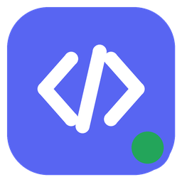

<p align="center"></p>

# Studiocord

Discord Rich Presence for Roblox Studio, on **Windows** and on **Linux** (Studio via
[Vinegar](https://vinegarhq.org)).

It runs in the background and checks for Roblox Studio every 2 seconds. While Studio
runs, it reads Studio's own log files and shows what you're doing:

| In Studio                     | On Discord                                              |
|-------------------------------|---------------------------------------------------------|
| Start page, no place open     | On the start page                                       |
| Place open, 3D view           | Editing *Place name* · Building                         |
| Script tab focused            | Editing *Place name* · Editing *ScriptName* (*n* lines) |
| Play / Run test               | Editing *Place name* · Playtesting                      |
| Team Create connected         | … · Team Create                                         |
| Local `.rbxl` file            | Editing *file name*                                     |
| New place from a template     | Editing a new place (Baseplate)                         |
| Studio closed                 | presence cleared                                        |

Published places also get their game icon and a "View on Roblox" button. Names and icons
come from Roblox's public web APIs, with no login.

## Install

Download the latest version from **[Releases](../../releases/latest)**. You don't need Python.

### Windows

Run **`Studiocord-Setup.exe`**. It installs for your user only, so it doesn't need admin
rights. It starts right away and then starts with Windows. It has no window: open Discord
and Roblox Studio and your status appears.

- Settings: Start menu → Studiocord → *Studiocord settings*
- Log: Start menu → Studiocord → *Studiocord log*
- Uninstall: Settings → Apps, or Start menu → Studiocord → *Uninstall Studiocord*

Windows SmartScreen may warn about the installer because it isn't code-signed. Click
*More info* → *Run anyway*.

### Linux

Download **`Studiocord-Installer-Linux`**, make it executable and run it:

```sh
chmod +x Studiocord-Installer-Linux
./Studiocord-Installer-Linux
```

It copies itself to `~/.local/share/studiocord/`, sets itself up to start at login (a systemd
user service, or an autostart entry on systems without systemd) and starts. You can delete
the downloaded file afterwards. To update, run the newer installer the same way.

```sh
journalctl --user -u studiocord -f              # live log
systemctl --user restart studiocord             # after editing the settings
~/.local/share/studiocord/studiocord --uninstall
```

Settings: `~/.config/studiocord/config.toml`.

On Linux, Studiocord works with Roblox Studio running through Vinegar. If Vinegar's own
"Discord Rich Presence" option works for you, turn one of them off so they don't fight.
Vinegar 1.9.4's built-in presence doesn't work with newer Kombucha (Wine) builds, which
is why Studiocord reads the log files directly.

## Script names

Studio doesn't log which script you're editing, so Studiocord puts a small helper plugin,
`Studiocord.lua`, into Studio's local Plugins folder. The plugin sends the focused script's
name, path and line count to Studiocord on `127.0.0.1:47231`, and only there. The first
time, Studio asks whether the plugin may make HTTP requests to 127.0.0.1: click **Allow**.
Without the plugin, the status just says "Editing a script".

Studiocord checks every 15 seconds that the plugin is still there and up to date, and puts
it back if it was deleted or Studio was reinstalled. Studio loads a newly added plugin
right away, but an updated plugin only takes effect after restarting Studio.

## Settings

See [`config.example.toml`](config.example.toml). Everything can be turned off, for
example place names, the button, script names and line counts.

## Running from source

Needs Python 3.11 or newer and nothing else.

```sh
python3 -m studiocord              # run in the foreground
python3 -m studiocord --diagnose   # show what it finds (logs, Studio, Discord, plugin folder)
python3 -m studiocord --dry-run    # live, but print the status instead of sending it
python3 -m studiocord --replay <Studio log file>   # replay an old Studio session
./install.sh                       # Linux: run this checkout as a systemd user service
```

Building the standalone programs: `pip install pyinstaller && python build.py`. On Windows,
then run `iscc installer\studiocord.iss` (Inno Setup 6).

Releases come from GitHub Actions ("Build & release"). Running it by hand with *publish*
ticked builds both programs and publishes them as a **pre-release** for the version in
`studiocord/__init__.py`, replacing the previous pre-release of that version. Make it a
full release with `gh release edit v1.0.0 --prerelease=false --latest`.

## Layout

- `studiocord/studio_log.py` turns Studio log lines into a state (place, script, playtest, Team Create).
- `studiocord/system.py` holds everything that differs between Windows and Linux: folders, finding Studio, Discord's endpoints.
- `studiocord/discord_ipc.py` is a tiny Discord IPC client (Unix socket or Windows named pipe).
- `studiocord/script_server.py` is the localhost endpoint the plugin talks to.
- `studiocord/roblox_api.py` looks up place names and icons in the background.
- `studiocord/installer.py` is the self-installer for the Linux build.
- `studiocord/__main__.py` runs the main loop.
- `plugin/Studiocord.lua` is the Studio plugin that reports the focused script.
- `installer/` holds the Windows installer script (Inno Setup) and the icon.

## License

MIT, see [LICENSE](LICENSE).

---

<sub>Studiocord by JonasTheCoderX</sub>
